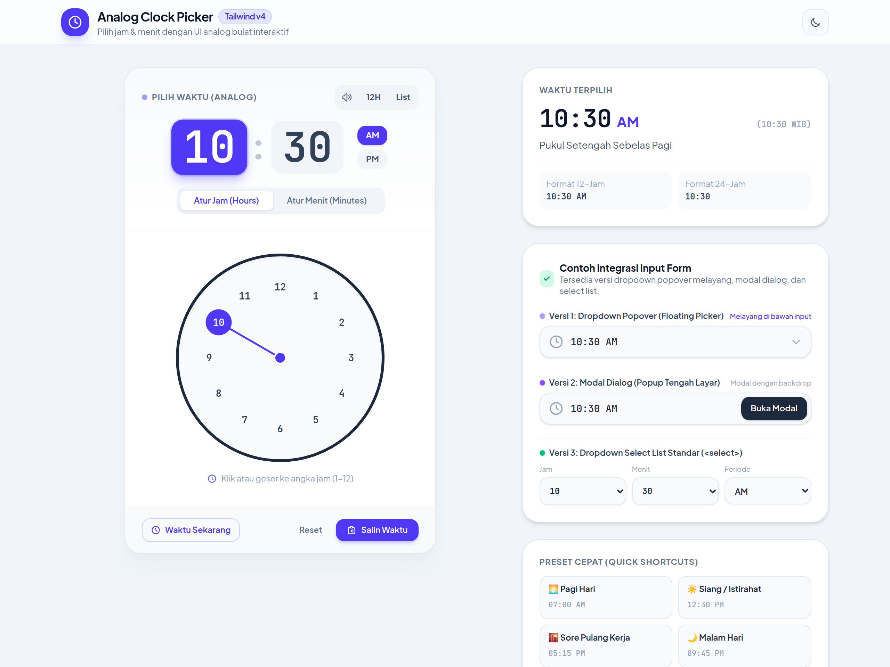
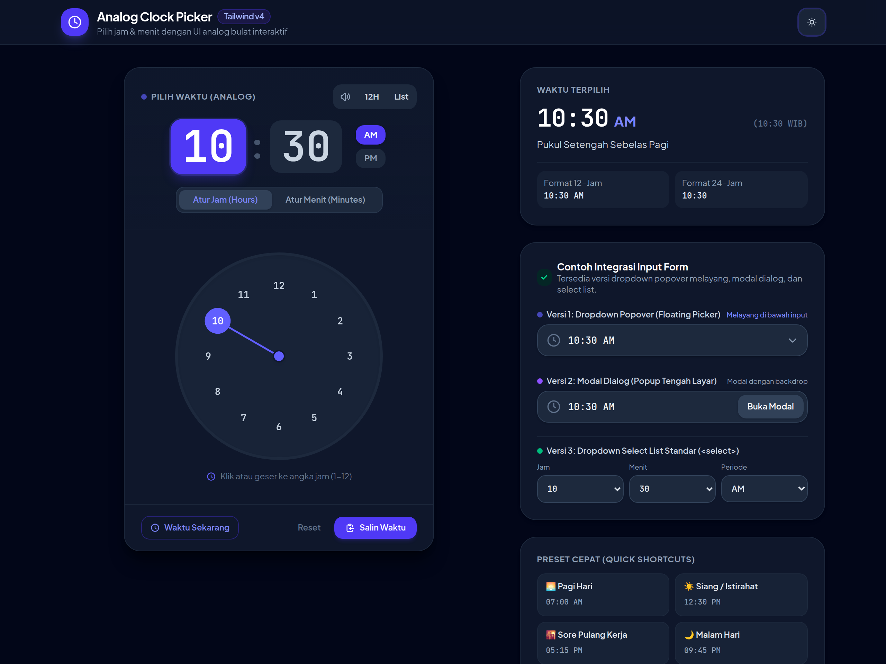
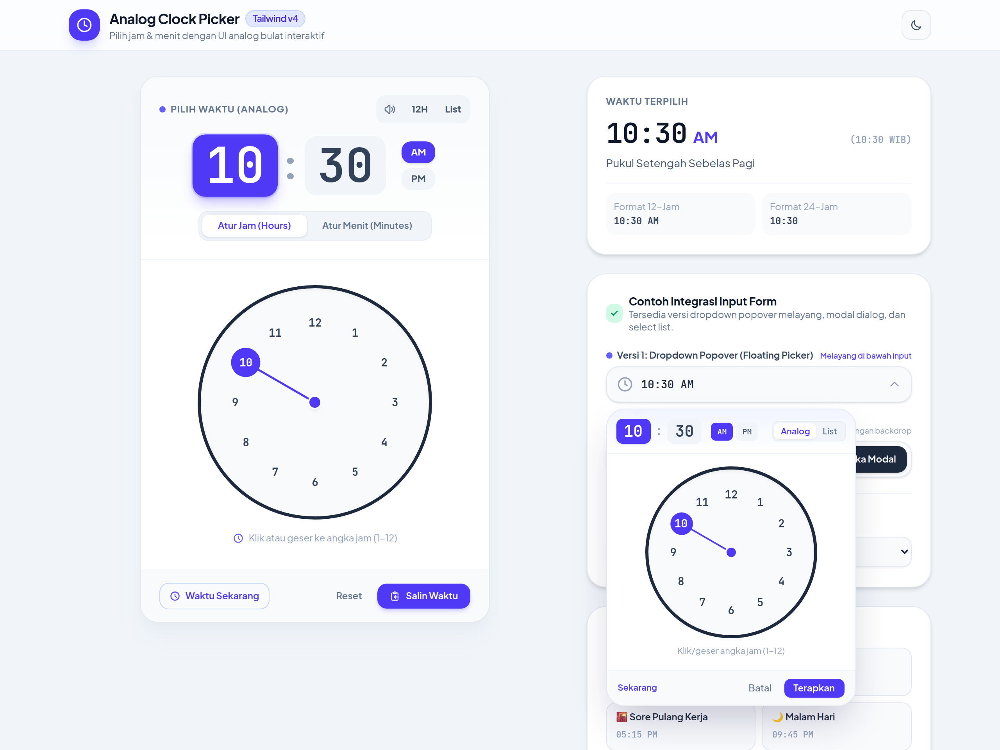
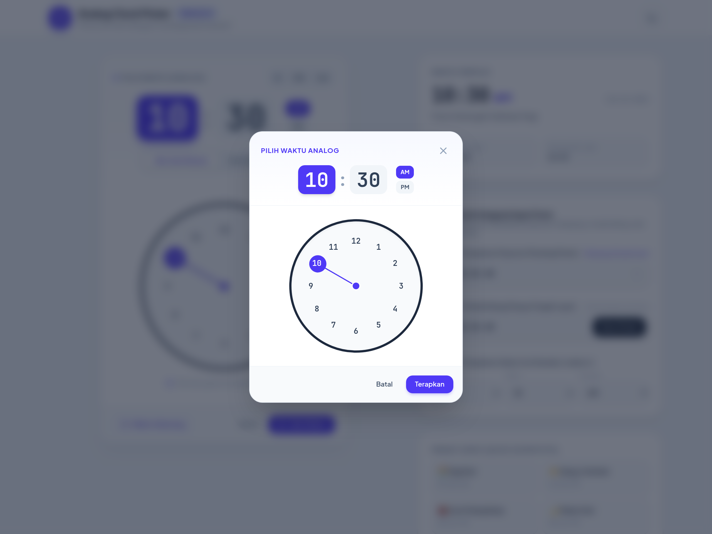
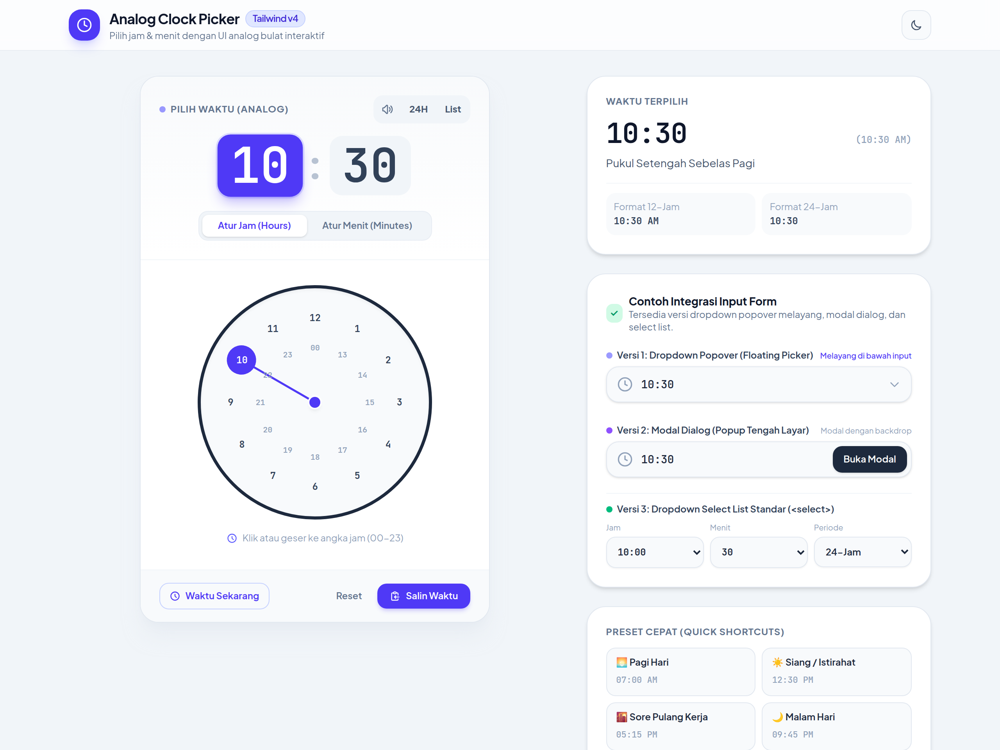

# @harmonidata/analog-clockpicker

<p align="center">
  <a href="./LICENSE"></a>
  <a href="https://tailwindcss.com"></a>
  <a href="https://vuejs.org"></a>
  <a href="src/index.d.ts"></a>
  
</p>

<p align="center">
  <strong>Komponen pemilih waktu (<em>timepicker</em>) analog melingkar modern dengan animasi rotasi sapuan jarum jam halus (<em>smooth rotational sweep</em>), feedback suara mekanik taktil, dan integrasi penuh Tailwind CSS.</strong>
</p>

Tersedia dalam arsitektur **Hybrid**:
- 🌐 **Vanilla JavaScript Core**: Ringan, tanpa dependensi eksternal, dapat digunakan di HTML statis, Laravel Blade, React, PHP, dsb.
- 💚 **Vue 3 Adapter**: Dilengkapi komponen siap pakai `<ClockPicker />` yang mendukung `v-model`, serta composable `useClockPicker()`.

---

## 📑 Daftar Isi

- [✨ Fitur Utama](#-fitur-utama)
- [📸 Tampilan Antarmuka](#-tampilan-antarmuka)
- [📦 Cara Install](#-cara-install)
- [🚀 Panduan Penggunaan](#-panduan-penggunaan)
  - [Vanilla JS / HTML / Laravel Blade](#1-vanilla-js--html--laravel-blade)
  - [Vue 3 Komponen](#2-vue-3---komponen-clockpicker-)
  - [Vue 3 Composable](#3-vue-3---composable-useclockpicker)
- [⚙️ Opsi Konfigurasi](#️-opsi-konfigurasi)
- [🛠️ Method & Event API](#️-method--event-api)
- [💻 Development](#-development)
- [🤝 Kontribusi](#-kontribusi)
- [📄 Lisensi](#-lisensi)

---

## ✨ Fitur Utama

- 🔄 **Animasi Rotasi Fisika Halus**: Sapuan jarum jam berputar searah jarum jam (*clockwise rotation*) menggunakan `requestAnimationFrame` dan kurva interpolasi `easeOutCubic`, bukan lompat koordinat acak.
- 🔊 **Tactile Web Audio Feedback**: Detikan mekanik realistis saat jarum melewati angka secara real-time via Web Audio API tanpa memerlukan file audio eksternal.
- 🌓 **Dukungan Tema Terang & Gelap**: Desain modern berbasis utilitas Tailwind CSS yang otomatis beradaptasi dengan mode gelap (`.dark`).
- ⏱️ **Format 12-Jam & 24-Jam**: Mendukung format standar 12-jam (AM/PM) dan format 24-jam dengan cincin angka konsentris ganda (*dual concentric ring*).
- 🪟 **Tiga Mode Integrasi**:
  - `dropdown`: Popover mengambang tepat di bawah elemen input.
  - `modal`: Dialog terpusat di layar dengan efek *backdrop blur*.
  - `inline`: Komponen tertanam langsung di dalam tata letak halaman.
- ⚡ **Zero Runtime Dependencies**: Core Vanilla JS murni, ukuran bundle minimal, dan rendering SVG yang sangat efisien.
- 🇮🇩 **Deskripsi Waktu Alami Bahasa Indonesia**: Menghasilkan deskripsi natural otomatis (contoh: *"Pukul Sepuluh Tiga Puluh Pagi"*).
- 🦾 **TypeScript Ready**: Dilengkapi dengan berkas deklarasi tipe (`.d.ts`) lengkap untuk Vanilla JS dan Vue 3.

---

## 📸 Tampilan Antarmuka

### 🌓 Mode Terang (Light) & Mode Gelap (Dark)

| Light Theme | Dark Theme |
| :---: | :---: |
|  |  |

### 🪟 Variasi Integrasi

| Dropdown Popover | Modal Dialog | Mode 24-Jam (Concentric Ring) |
| :---: | :---: | :---: |
|  |  |  |

---

## 📦 Cara Install

Pilih metode instalasi sesuai kebutuhan proyek Anda:

### Menggunakan NPM / Yarn / PNPM

```bash
# Langsung dari GitHub Repository
npm install github:harmonidata/analog-clockpicker

# Atau jika menggunakan Yarn / PNPM
yarn add github:harmonidata/analog-clockpicker
pnpm add github:harmonidata/analog-clockpicker
```

### Menggunakan NPM Registry

```bash
npm install @harmonidata/analog-clockpicker
```

---

## 🚀 Panduan Penggunaan

### 1. Vanilla JS / HTML / Laravel Blade

Hubungkan elemen input dengan `ClockPicker`:

```html
<!-- Input field pada template Anda -->
<div class="relative">
  <input 
    type="text" 
    id="timeInput" 
    placeholder="Pilih waktu..." 
    class="border border-slate-300 rounded-xl px-4 py-2 focus:ring-2 focus:ring-indigo-500"
  />
</div>

<script type="module">
  import { ClockPicker } from '@harmonidata/analog-clockpicker';
  import '@harmonidata/analog-clockpicker/style.css';

  const picker = new ClockPicker('#timeInput', {
    mode: 'dropdown',     // 'dropdown' | 'modal' | 'inline'
    format24: false,      // false (12-jam AM/PM) atau true (24-jam)
    sound: true,          // Efek suara detikan mekanik Web Audio API
    autoAdvance: true,    // Otomatis berpindah ke menit setelah jam dipilih
    initialTime: '10:30 AM',
    onChange: (time) => {
      console.log('Waktu dipilih:', time.time12, time.time24, time.timeIndo);
    },
    onApply: (time) => {
      console.log('Waktu diterapkan:', time.formatted);
    }
  });

  // Contoh kontrol programatis:
  // picker.open();
  // picker.close();
  // picker.setNow();
  // picker.animatePreset(14, 0, 'PM');
</script>
```

---

### 2. Vue 3 - Komponen `<ClockPicker />`

Komponen siap pakai dengan dukungan penuh `v-model`:

```vue
<script setup>
import { ref } from 'vue';
import { ClockPicker } from '@harmonidata/analog-clockpicker/vue';
import '@harmonidata/analog-clockpicker/style.css';

const selectedTime = ref('10:30 AM');

function onTimeApplied(timeObj) {
  console.log('Waktu berhasil disimpan:', timeObj);
}
</script>

<template>
  <div class="max-w-md mx-auto p-6">
    <label class="block text-sm font-medium text-slate-700 dark:text-slate-300 mb-2">
      Jadwal Pertemuan:
    </label>
    
    <ClockPicker 
      v-model="selectedTime" 
      mode="dropdown"
      :format24="false"
      :sound="true"
      :autoAdvance="true"
      @apply="onTimeApplied"
    />

    <p class="mt-2 text-sm text-slate-500">
      Nilai saat ini: <span class="font-mono font-semibold">{{ selectedTime }}</span>
    </p>
  </div>
</template>
```

---

### 3. Vue 3 - Composable `useClockPicker()`

Gunakan composable jika Anda ingin membangun antarmuka jam kustom secara mandiri:

```vue
<script setup>
import { useClockPicker } from '@harmonidata/analog-clockpicker/vue';

const {
  hours,
  minutes,
  period,
  format24,
  time12,
  time24,
  timeIndo,
  isOpen,
  open,
  close,
  setNow,
  setTime,
  togglePeriod
} = useClockPicker({
  initialTime: '08:00 AM',
  format24: false,
  sound: true
});
</script>

<template>
  <div>
    <button @click="open" class="px-4 py-2 bg-indigo-600 text-white rounded-lg">
      Waktu Terpilih: {{ time12 }} ({{ timeIndo }})
    </button>
  </div>
</template>
```

---

## ⚙️ Opsi Konfigurasi

Daftar opsi yang didukung pada Vanilla `ClockPicker` maupun props komponen Vue `<ClockPicker />`:

| Properti | Tipe | Default | Keterangan |
|---|---|---|---|
| `mode` | `'dropdown' \| 'modal' \| 'inline'` | `'dropdown'` | Mode tampilan: popover melayang di bawah input, modal terpusat dengan backdrop blur, atau inline tertanam. |
| `format24` | `boolean` | `false` | `false` untuk sistem 12 jam (AM/PM) atau `true` untuk sistem 24 jam dengan dua cincin angka konsentris. |
| `sound` | `boolean` | `true` | Mengaktifkan suara detikan mekanik taktil via Web Audio API saat jarum jam bergerak melewati angka. |
| `autoAdvance` | `boolean` | `true` | Otomatis berpindah dari seleksi jarum jam ke seleksi jarum menit setelah angka jam dipilih. |
| `dialSize` | `number` | `240` | Diameter dial jam analog dalam satuan piksel (px). |
| `initialTime` | `string` | `'10:30 AM'` | Waktu awal yang disetel saat inisialisasi (contoh: `'08:00 AM'` atau `'14:30'`). |
| `presets` | `Array<Preset>` | `[...]` | Daftar tombol pintas preset waktu (Pagi, Siang, Sore, Malam). |
| `onChange` | `(time) => void` | `null` | Callback yang dipanggil setiap kali posisi jarum jam atau menit bergeser. |
| `onApply` | `(time) => void` | `null` | Callback yang dipanggil saat pengguna menekan tombol **Terapkan** (*Apply*). |

---

## 🛠️ Method & Event API

### Method Instance `ClockPicker`

| Method | Parameter | Deskripsi |
|---|---|---|
| `picker.open()` | - | Membuka antarmuka picker (mode dropdown / modal). |
| `picker.close()` | - | Menutup antarmuka picker. |
| `picker.toggle()` | - | Buka atau tutup antarmuka picker secara bergantian. |
| `picker.getTime()` | - | Mengembalikan objek informasi waktu saat ini. |
| `picker.setTime(h, m, p)` | `hours, minutes, period` | Menyetel nilai waktu secara manual. |
| `picker.setNow()` | - | Memutar jarum jam secara halus ke waktu sistem lokal saat ini. |
| `picker.animatePreset(h, m, p)` | `hours, minutes, period` | Melakukan animasi putaran jarum jam halus berurutan (*clockwise sweep*) ke target waktu preset. |
| `picker.destroy()` | - | Menghapus elemen picker dari DOM dan membersihkan event listener. |

### Struktur Objek Waktu (`TimeObject`)

Objek waktu yang diterima pada callback `onChange`, `onApply`, atau `getTime()`:

```typescript
{
  hours: number;         // Angka jam (1-12 atau 0-23)
  minutes: number;       // Angka menit (0-59)
  period: 'AM' | 'PM';   // Periode waktu
  time12: string;        // Contoh: "10:30 AM"
  time24: string;        // Contoh: "22:30"
  timeIndo: string;      // Contoh: "Pukul Sepuluh Tiga Puluh Pagi"
  formatted: string;     // String terformat sesuai format24 yang aktif
}
```

---

## 💻 Development

Bagi Anda yang ingin berkontribusi atau menguji coba secara lokal:

```bash
# 1. Kloning repositori
git clone https://github.com/harmonidata/analog-clockpicker.git
cd analog-clockpicker

# 2. Pasang dependensi
npm install

# 3. Jalankan development playground
npm run dev

# 4. Bangun paket distribusi (ESM, CJS, TypeScript types, dan CSS)
npm run build
```

---

## 🤝 Kontribusi

Kontribusi, pelaporan bug, dan saran fitur baru sangat kami apresiasi!
Silakan buka [Issue](https://github.com/harmonidata/analog-clockpicker/issues) atau ajukan [Pull Request](https://github.com/harmonidata/analog-clockpicker/pulls).

1. Fork repositori ini
2. Buat branch fitur baru (`git checkout -b feature/fitur-keren`)
3. Commit perubahan Anda (`git commit -m 'feat: tambah fitur keren'`)
4. Push ke branch Anda (`git push origin feature/fitur-keren`)
5. Buka Pull Request

---

## 📄 Lisensi

Didistribusikan di bawah lisensi MIT. Lihat berkas [LICENSE](./LICENSE) untuk informasi lebih lanjut.

Copyright &copy; 2026 [HarmoniData](https://github.com/harmonidata). All rights reserved.
